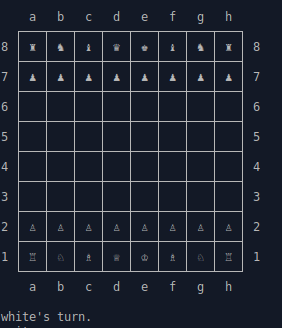
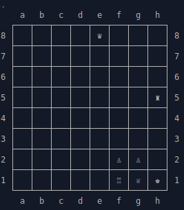

# Chess
An assignment from [The Odin Project](https://www.theodinproject.com/) to implement a two player game of chess using Ruby.

Additional information can be found at https://www.theodinproject.com/lessons/ruby-ruby-final-project.

## How to Play

| <code>ruby lib/game.rb</code>

An image of the chess board will be displayed with rows labelled with the numbers **1** to **8** and the columns labeled by letters **a** to **h**. Chess pieces are represented by the unicode chess symbols.
White starts and is on the bottom of the board.

Input is in the form <code>(col)(row) to (col)(row)</code>. For example, an opening move by white could be <code>a2 to a4</code>.

Information on turns, invalid input, check, promotions, and checkmate will be printed on the console.

|<code>exit</code> can be used at any time to quit the game.

## Features

- Ensures valid moves. This includes the common moves of each of the nine pieces as well as special cases such as *castling*, *promoting*, and *en passant*
- Determines when the game ends. In addition to *checkmate* this includes *stalemate* and some *dead positions* (king against king, king against king and bishop, king against king and knight, king and bishop against king and bishop, with both bishops on squares of the same color). 

## Technologies
- Written in Ruby.
- Git for version control
- rspec for unit tests
